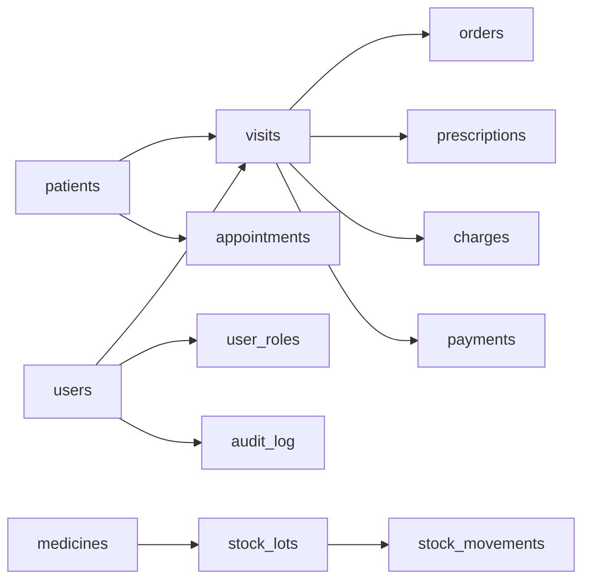

Bản đồ: [[BD-CONG-CU-THIET-BI]]

# Đặc tả hệ thống sơ bộ — Phòng khám đa khoa Minh Đức

**Ngày ghi nhận:** 08/11/2026. **Trạng thái:** NHAP. **Phạm vi:** Khảo sát bước 1–12 và thử nghiệm lập trình v0.1.0.

## I. Mục tiêu và các quyết định do người dùng xác nhận

1. **Quy mô:** Phòng khám đa khoa Minh Đức, dưới 30 bệnh nhân/ngày, 19 vị trí nhân sự khai báo: 6 bác sĩ, 2 điều dưỡng, 1 kỹ thuật viên, 1 dược, 3 lễ tân, 5 thu ngân, 1 quản lý. Chưa xác minh số người thực, số nhân sự kiêm nhiệm và số người dùng đồng thời.
2. **Nghiệp vụ:** tiếp đón, khám nội/tổng quát, khám chuyên khoa, xét nghiệm, siêu âm, X-quang, điện tim, thủ thuật, tiêm truyền, cấp thuốc, thu ngân. Đã biết 1 bác sĩ Nội, 1 Sản, 1 Chẩn đoán hình ảnh, 1 Y học cổ truyền; 2 bác sĩ chưa rõ chuyên khoa.
3. **Hạ tầng:** 1–2 máy tính, Internet ổn định, mong muốn truy cập nội bộ và từ xa; kết nối thiết bị y tế theo lộ trình. Tên hãng/model các thiết bị chưa được cung cấp.
4. **Bệnh nhân:** tiếp nhận trực tiếp và đặt lịch trước, chỉ khám dịch vụ tự thanh toán, hiện lưu hồ sơ giấy; lễ tân chủ động phân bác sĩ/phòng. Thông tin cần có: họ tên, sinh/tuổi, giới tính, số điện thoại, căn cước nếu có, địa chỉ. Dự kiến mã hồ sơ nội bộ riêng.
5. **Lâm sàng:** hồ sơ khám chi tiết có cấu trúc; nhân viên có thể hỗ trợ nhập chỉ định theo phân quyền nhưng người có thẩm quyền phải xác nhận; kết quả cận lâm sàng được nhập, duyệt, bác sĩ xem lại/kết luận. Thanh toán trước/sau/nhiều lần. Đơn thuốc cấp tại cơ sở hoặc mua ngoài. Số hóa hồ sơ, duy trì hồ sơ giấy khi cần.
6. **Nhà thuốc:** bộ phận cấp thuốc thuộc cơ sở, một kho tập trung, hiện dùng sổ giấy, cấp nguyên hộp/vỉ và lẻ theo viên/ống/gói. Nhóm thuốc hóa dược, thuốc không kê đơn/vitamin, vật tư, thuốc thủ thuật/tiêm truyền, thuốc phải kiểm soát đặc biệt. Bộ phận thu ngân thu chung. **Không kê thuốc y học cổ truyền**, chỉ khám/điều trị chuyên khoa YHCT.
7. **Tài chính:** tiền mặt, chuyển khoản QR; một quỹ chung, theo dõi người thực hiện; cho phép trả một phần và công nợ; in phiếu thu; mọi hoàn/hủy/giảm giá phải được quản lý phê duyệt. Bảng giá chung. Báo cáo doanh thu theo kỳ, thuốc/tồn kho, công nợ, chi phí/giá vốn/lợi nhuận.
8. **Quản trị:** một quản trị viên chính; tài khoản cá nhân có thể mang nhiều vai trò; bệnh án chỉ cho nhân viên chuyên môn được phân công và người có thẩm quyền. Truy cập từ xa chỉ dành cho quản lý và bác sĩ được cấp quyền; chỉ thiết bị đã đăng ký/phê duyệt; chỉ quản lý xem tài chính tổng hợp. RPO được người dùng chọn là **tối đa 24 giờ**, nhưng nhóm thiết kế khuyến nghị mục tiêu thấp hơn cho dữ liệu y tế. RTO chưa xác định.
9. **Giao diện:** web responsive, màu xanh ngọc–trắng, thiết kế y tế hiện đại; trang chủ/menu theo vai trò; cân đối mật độ hiển thị; tên và logo riêng (chưa nhận tệp logo).
10. **Bước 12:** hiện đã có một số mẫu, cần bổ sung. Ưu tiên 5 nhóm: (i) phiếu đăng ký, tiếp đón, phiếu khám; (ii) phiếu chỉ định xét nghiệm/siêu âm/X-quang/điện tim; (iii) phiếu kết quả xét nghiệm; (iv) phiếu kết quả siêu âm/X-quang/điện tim; (v) đơn thuốc ngoại trú và hẹn tái khám. Máy in Canon laser đen trắng và Epson màu (chưa rõ model, cách kết nối và kích thước thực tế). Nhập tay/tải tệp ở giai đoạn đầu, tích hợp tự động giai đoạn sau. Chưa có chữ ký số chuyên môn.

## II. Bản đồ màn hình và luồng công việc

### Vai trò, màn hình

| Vai trò | Trang chủ / chức năng ưu tiên | Thông tin bị hạn chế |
|---|---|---|
| Lễ tân | Tra bệnh nhân, tạo hồ sơ, đặt lịch, tiếp nhận, phân bác sĩ | Không xem diễn biến bệnh án, kết quả chuyên môn |
| Bác sĩ | Lượt khám được giao, bệnh án, chỉ định, kết quả đã duyệt, đơn thuốc | Không xem bệnh án người khác nếu chưa có quyền |
| Điều dưỡng | Sinh hiệu, y lệnh, ghi nhận thực hiện được giao | Không tự ký thay bác sĩ, quyền hồ sơ theo phân công |
| Kỹ thuật viên | Phiếu chỉ định, nhập/tải kết quả, chuyển duyệt | Không truy cập dữ liệu tài chính và phần khám không liên quan |
| Dược | Danh sách đơn hợp lệ, nhập/xuất/tồn theo lô, kiểm kê | Không chỉnh đơn bác sĩ; thuốc đặc biệt quản lý riêng |
| Thu ngân | Bảng kê, khoản thu một quỹ chung, công nợ | Không xem bệnh án và báo cáo lợi nhuận tổng hợp |
| Quản lý | Tổng quan doanh thu, công nợ, chi phí, phê duyệt | Hồ sơ y tế theo thẩm quyền và nhu cầu chính đáng |
| Quản trị | Cấu hình, tài khoản, thiết bị, nhật ký, sao lưu | Không mặc nhiên có quyền xem nội dung bệnh án |

Luồng chính: tiếp nhận / lịch hẹn → tạo lượt khám + phí khám → bác sĩ khám → chỉ định dịch vụ → kỹ thuật viên nhập + đính kèm → người có thẩm quyền xác nhận → bác sĩ xem/kết luận → đơn nháp/đơn ký hợp lệ về sau → thanh toán nhiều lần / công nợ → cấp phát đúng đơn và lô về sau.

Các giao dịch thuốc phải kiểm soát đặc biệt, kê đơn điện tử có giá trị pháp lý, ký số và phát hành hóa đơn **không có trong bản v0.1**.

## III. Phạm vi bản thử nghiệm v0.1.0 được lập trình

| Mô-đun | API / thao tác chạy được | Chưa có / giới hạn |
|---|---|---|
| Đăng nhập | 9 tài khoản demo, mật khẩu băm PBKDF2, phiên token, kiểm tra vai trò | Chưa có MFA, cấp/thu hồi thiết bị, chống dò mật khẩu, TLS |
| Bệnh nhân | Thêm, tìm, xem theo quyền, mã MD000001, kiểm trùng căn cước | Chưa nhập Excel/scan giấy, kiểm tra trùng phức hợp, mã hóa CSDL |
| Lịch hẹn | Tạo và liệt kê lịch theo bác sĩ/bệnh nhân | Chưa cho bệnh nhân tự đặt lịch, nhắc hẹn, kiểm tra trùng giờ |
| Lượt khám | Lễ tân phân bác sĩ, tạo lượt + phí dịch vụ mẫu | Chưa phân luồng phòng/ghế, đổi bác sĩ/phân ca |
| Hồ sơ | Bác sĩ được giao nhập khám; chống ghi đè bằng số phiên bản | Chưa xác nhận chuyên môn có giá trị pháp lý, ký số, khóa hồ sơ |
| Cận lâm sàng | Bác sĩ lập chỉ định; kỹ thuật viên nhập và tải PDF/ảnh; bác sĩ phụ trách duyệt mô phỏng | Chưa duyệt theo chức danh chuyên khoa, DICOM/HL7, tự kết nối máy |
| Đơn thuốc | Tạo, xem và in **đơn nháp giả lập** | Không kê đơn có giá trị sử dụng, không truyền đơn điện tử, không cấp thuốc |
| Nhà thuốc | Xem thuốc/lô, nhập thêm lô thuốc thường có nhật ký | Chưa xuất/đổi đơn vị/FEFO; cấm tiếp nhận thuốc phải kiểm soát đặc biệt |
| Tài chính | Phí khám mẫu, thanh toán từng phần, chống ghi lặp, không vượt công nợ, quản lý 1 quỹ | Chưa hoàn tiền, hủy có phê duyệt, giá vốn, chi phí, hóa đơn điện tử |
| Tổng quan | Quản lý thấy doanh thu phí mẫu / đã thu / còn thu | Không tính lợi nhuận nếu chưa nhập chi phí, không dùng quyết toán |
| In ấn | In từ trình duyệt phiếu khám, kết quả đã duyệt mô phỏng, đơn nháp | Chưa có mẫu thẩm định, thiếu thông tin pháp nhân và chữ ký |

## IV. Mô hình cơ sở dữ liệu sơ bộ

**Nền tảng hiện thực:** SQLite, quan hệ và khóa ngoại. **Mục tiêu khi triển khai thật:** PostgreSQL, migration có phiên bản, backup theo thời điểm, phân quyền dữ liệu và mã hóa được thẩm định. File SQL chạy thử ở `schema.sql`.

| Bảng | Khóa, trường chính | Liên kết và nguyên tắc |
|---|---|---|
| `users` | `id`, `username`, `salt`, `password_hash`, `active` | Mỗi người có tài khoản riêng |
| `user_roles` | `(user_id, role)` | Một tài khoản có nhiều vai trò |
| `sessions` | `token_hash`, `user_id`, `expires_at` | Mã phiên băm; 8 giờ trong demo |
| `patients` | `id`, `code`, `full_name`, `date_of_birth`, `sex`, `phone`, `citizen_id`, `address` | Mã bệnh nhân nội bộ duy nhất; định danh không là khóa chính |
| `appointments` | `id`, `patient_id`, `doctor_id`, `scheduled_at`, `status` | Lịch hẹn → lượt khám |
| `visits` | `id`, `patient_id`, `doctor_id`, `created_by`, `status`, `clinical fields`, `version` | Mỗi bệnh nhân có nhiều lượt, gán bác sĩ; chống ghi đè |
| `service_catalog` | `id`, `name`, `price` | Bảng giá dịch vụ mẫu |
| `charges` | `id`, `visit_id`, `label`, `amount` | Khoản phải thu của từng lượt khám |
| `orders` | `id`, `visit_id`, `category`, `name`, `status`, `result_text`, `file_key`, `approved_by` | Chỉ định → kết quả → duyệt mô phỏng |
| `prescriptions` | `id`, `visit_id`, `doctor_id`, `drug_lines`, `instructions`, `status` | Demo chỉ có nháp, không hợp lệ để cấp thuốc |
| `payments` | `id`, `visit_id`, `amount`, `method`, `created_by`, `idempotency_key` | Một quỹ chung; ghi người thu; chống thu lặp và vượt công nợ |
| `medicines` | `id`, `name`, `base_unit`, `controlled` | Danh mục hàng mẫu |
| `stock_lots` | `id`, `medicine_id`, `lot_number`, `expiry_date`, `quantity`, `quarantined` | Tồn theo lô; không âm kho |
| `stock_movements` | `id`, `stock_lot_id`, `movement_type`, `quantity`, `created_by` | Sổ nhận hàng mẫu không xóa |
| `audit_log` | `id`, `user_id`, `event`, `object_type`, `object_id`, `created_at` | Lịch sử thao tác trọng yếu |

Quy tắc tài chính: khoản còn phải thu = tổng phí phát sinh - tổng khoản thu, trong phạm vi phiên bản demo chưa có hoàn tiền, giảm giá hoặc điều chỉnh. Khi mở rộng phải bổ sung sổ phụ cho hoàn/giảm/ứng trước và đối soát, không sửa trực tiếp giao dịch đã chốt.

Quy tắc lâm sàng: không dùng câu chữ “đã ký” khi chưa có chữ ký số; kết quả duyệt trong demo chỉ minh họa chuyển trạng thái. Quy tắc kho: nhập nguyên số lượng theo đơn vị cơ sở; không cho xuất thuốc kiểm soát đặc biệt trong demo.

## V. Những dữ liệu còn thiếu hoặc mâu thuẫn cần giải quyết

1. **Pháp nhân/giấy phép/địa chỉ/tên trên chứng từ:** chưa có tên đầy đủ theo giấy phép, giấy phép hoạt động, mã số thuế, địa chỉ, thông tin nhân sự người có thẩm quyền ký; chưa quyết định nhà cung cấp hóa đơn điện tử. Không tự in các thông tin này.
2. **Biểu mẫu gốc:** người dùng đã chọn 5 nhóm, nhưng chưa cung cấp ảnh/PDF/Word gốc; mẫu đơn thuốc và kết quả cần đối chiếu quy định đang hiệu lực. Không coi bản in nháp hiện tại là mẫu hợp pháp.
3. **Logo và máy in:** tên Minh Đức đã có; chưa nhận logo PNG/SVG, model Canon/Epson, kích thước giấy thực tế, driver và kết nối. In A5 chưa kiểm bản in theo mẫu.
4. **Thiết bị y tế:** chưa có hãng/model, giao thức DICOM/HL7/ASTM/API, bản quyền phần mềm máy; chưa thể tự động lấy kết quả. Chi tiết PACS, DICOM nguyên gốc chưa thống nhất.
5. **Nhân sự và phân quyền:** còn hai bác sĩ chưa rõ chuyên khoa; số tài khoản dùng đồng thời, kiêm nhiệm, phân công điều dưỡng/kỹ thuật viên theo từng lượt, cơ chế người duyệt kết quả chưa chốt.
6. **Dược:** chưa có danh mục thuốc thật, quy cách quy đổi, giá nhập/xuất, hạn dùng, danh sách thuốc kiểm soát đặc biệt, quy trình thực tế kho và phân công người chịu trách nhiệm chuyên môn.
7. **Tài chính:** giá khám trong demo không phải bảng giá Minh Đức; thiếu chi phí, giá vốn, quy trình hóa đơn, các khoản giảm giá/hoàn tiền/hủy được phê duyệt.
8. **Bảo mật và vận hành:** người dùng chọn RPO 24 giờ nhưng cần xem lại mức mất dữ liệu y tế; RTO chưa biết. Chưa có nhà cung cấp cloud, quản lý thiết bị, khôi phục, mã hóa và kiểm toán an toàn thông tin.
9. **YHCT:** người dùng xác nhận không kê thuốc cổ truyền; chỉ xây dựng phiếu khám/điều trị YHCT. Cần đặc tả thủ thuật/phương pháp điều trị cụ thể khi biết giấy phép.

## VI. Lộ trình tiếp theo và tiêu chí nghiệm thu

**v0.1 (đã tạo):** API + SQLite cục bộ + giao diện responsive + 10 bài test API; data giả lập; không mở Internet.

**v0.2 (đề xuất):** import hồ sơ giấy theo lô có kiểm tra trùng; phân công điều dưỡng và duyệt kết quả theo năng lực; danh mục dịch vụ; tách tài chính kế toán; mẫu in PDF/A4/A5 được thẩm định; backup/restore tự động và thử nghiệm.

**v0.3 (đề xuất):** phiên bản hóa schema và PostgreSQL; chữ ký điện tử phù hợp quy định; tích hợp đơn thuốc điện tử, hóa đơn, kho quy đổi/FEFO và thuốc kiểm soát đặc biệt; rà soát điều kiện pháp lý cơ sở.

**v1.0 (chỉ sau nghiệm thu):** kiểm thử bảo mật độc lập, đánh giá rủi ro dữ liệu cá nhân, hồ sơ pháp lý, liên thông thiết bị theo hãng và tài liệu kỹ thuật; kiểm thử đồng thời, hồi phục dữ liệu, tổ chức trực vận hành và bàn giao.

**Điểm chặn:** Không chuyển bản demo sang môi trường chứa hồ sơ thật trước khi hoàn thiện các kiểm soát và nghiệm thu nêu trên.

## VII. Nguồn hồ sơ và văn bản để đối chiếu

- Hồ sơ gốc: `2026-11-08_KHAO-SAT-PHAN-MEM-PHONG-KHAM-BUOC11_NHAP.md`, lập 08/11/2026, trạng thái NHAP; liên kết các bản bước 1–10.
- Hệ thống bản đồ: `00-CHATGPT-DOC-TRUOC` cập nhật 01/11/2026; `BD-CONG-CU-THIET-BI.md` cập nhật 01/11/2026.
- Quy tắc lưu: `00-CHATGPT-QUY-TAC-LUU-TRU` sửa đổi 08/11/2026.
- Trang văn bản Bộ Y tế: Thông tư 26/2025/TT-BYT trên cổng Chính phủ: https://vanban.chinhphu.vn/?classid=1&docid=214386&orggroupid=4&pageid=27160 . Cần kiểm nguyên văn, hiệu lực mới và văn bản sửa đổi tại thời điểm thẩm định biểu mẫu.
- Hướng dẫn triển khai FastAPI và TestClient: https://fastapi.tiangolo.com/tutorial/ ; https://fastapi.tiangolo.com/tutorial/testing/ .
